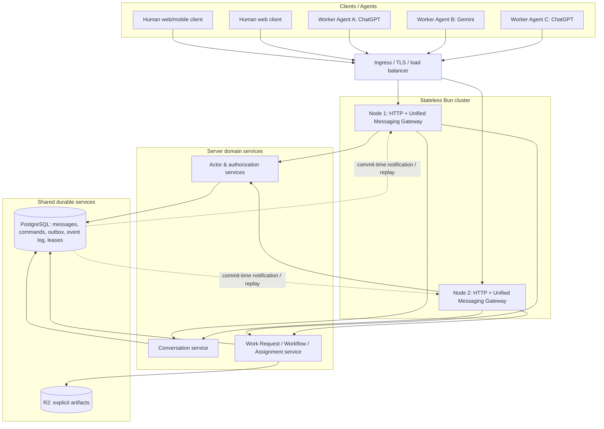
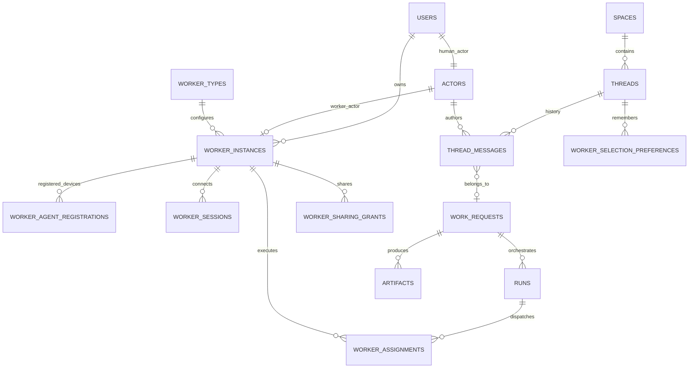

# Worker-first Syntila — Target System Architecture

**Status:** Proposal for implementation; requires ADR-031 approval.  
**Updated:** 2026-11-19  
**Scope:** Product resource model; message/execution semantics; database entities; actor security; local files; Worker management; single- and multi-node deployment.

## 1. System overview



All online Worker Instances each have **one logical Actor and one independent current authenticated WebSocket session**. One host can run many Agent processes. The backend never routes on host name or presumed physical machine. A local optional Worker Manager can manage several Agents but is not in the communication path.

Cloudflare retains human authentication and static web hosting per the VPS migration target. Bun verifies human identity tokens. Worker Agents use separate machine credentials provisioned through a human-authorized pairing flow. Worker runtime WebSockets and human browser realtime sockets use a shared gateway core but distinct authorization capabilities.

## 2. Vocabulary and boundaries

| Term | Definition | Lifecycle / security authority |
| --- | --- | --- |
| **User** | Authenticated human account, owner of Worker Instances | Cloudflare human auth + Bun user projection |
| **Actor** | Immutable message author/target principal; `human`, `worker`, or `system` | Server actor directory |
| **Worker Type** | Catalog entry (`chatgpt`, `gemini`, plugin type, etc.) | Published catalog/Profile management |
| **Worker Instance** | Owner's registered and schedulable AI agent with its own ID, display name and capabilities | Server plus its local Agent |
| **Worker Agent** | Local standalone process maintaining a Worker Instance's connection and executing assignments | Local agent with server-verified registration |
| **Worker Manager** | Optional host-level utility to install, supervise and update multiple Agents | Local OS/IPC only; not a required Cloud resource |
| **Space / Thread** | Collaboration container and conversation stream | Server Space/Thread permission rules |
| **Message** | Authoritative, persisted, user-visible conversation item | Conversation domain |
| **Work Request** | Authorized invocation of AI work with immutable selection/snapshot | Execution domain |
| **Assignment** | Durable command for a specific Worker Instance with attempt/lease identity | Execution domain + local journal |
| **Activity** | Progress or lifecycle observation; optional durable subset | Agent, execution service and realtime gateway |
| **Artifact** | Explicit shareable versioned output referenced by an id, not a host path | Artifact service/R2, access-grant checks |

One Actor ID per Worker Instance. Suggested identity scheme: `actor_id` opaque UUID for all actors and `worker_id` opaque UUID for Worker Instances; maintain immutable mapping. Do not encode Worker Type, name or platform in an ID. A Human Actor maps 1:1 to its existing user account. System Actors have fixed narrowly scoped server provenance.

## 3. Product resources and relationships



### 3.1 Worker instance fields (proposed)

```ts
interface WorkerInstance {
  id: string;                  // immutable, unique; required everywhere
  actorId: string;             // immutable worker Actor ID
  ownerUserId: string;         // immutable ownership except explicit transfer
  workerTypeId: string;        // type selects published Profile and UI catalog
  name: string;                // user-editable; duplicates allowed
  description?: string;        // user-supplied display hint; optional
  enabled: boolean;
  defaultModel?: string;       // validated against current type capabilities
  createdAt: string;
  updatedAt: string;
  revokedAt?: string;
}
```

Keep **configured enabled/disabled**, **observed online/offline** and **observed ready/not-ready** separate. A name change never changes the Actor ID. Worker Type changes should generally be represented by **create a new Worker Instance**; silently changing a Worker Type would invalidate Profile, sessions and capability evidence. If type migration is ever allowed, make it explicit, reviewed and restart/re-register required.

Do not force `UNIQUE(owner_user_id, name)`; add indexes on `(owner_user_id, created_at)` and `(worker_type_id)` as appropriate. Optional alias for the user's own picker can disambiguate duplicates. Historical messages save `author_actor_id` and optionally display snapshot; default UI can use current name with a historical fallback.

### 3.2 Worker Type versus instance

Keep the centrally published, signed Worker Profile per Worker Type (V9 model). Each instance inherits type capabilities (icon, available models, default Profile binding, provider executable metadata) but may override allowed per-instance settings: chosen model, allowed directories, local concurrency and auto-update policy. Execution snapshots freeze exact Worker ID, type, Profile digest/revision, model and permissions at acceptance.

The same type may have many instances, including duplicate names and instances installed on unrelated hosts. Type does not represent a singleton Worker or a connected session.

### 3.3 Actor is not a human account

Workers must not be inserted as regular user accounts for convenience. They have no email verification or human session; they cannot be invited as People, create Spaces, accept personal connections, change billing or read arbitrary owner data by default. Their authenticated machine principal gets only specific capabilities such as `worker:connect`, `assignment:receive`, `assignment:ack`, `assignment:activity`, `assignment:result`. Human principals get messaging/management rights from Space/Thread/ownership rules. Backend metadata includes actor authorship but never trusts `actorId` from unverified clients.

## 4. Conversation and execution model

### 4.1 Canonical Thread message model

Target table `thread_messages` (or a migration-compatible replacement for `discussion_messages`) stores user-visible message content and sender identity, independent of whether the sender is human or Worker:

```sql
-- Illustrative target schema; actual migration must account for existing IDs/FKs.
CREATE TABLE thread_messages (
  id text PRIMARY KEY,
  thread_id text NOT NULL REFERENCES threads(id),
  author_actor_id text NOT NULL REFERENCES actors(id),
  kind text NOT NULL CHECK (kind IN ('human', 'ai_request', 'ai_answer', 'system')),
  body text NOT NULL,
  work_request_id text NULL REFERENCES work_requests(id),
  reply_to_message_id text NULL,
  client_mutation_id text NULL,
  created_at timestamptz NOT NULL DEFAULT now(),
  edited_at timestamptz NULL,
  deleted_at timestamptz NULL,
  UNIQUE(work_request_id, kind) -- revise if multiple visible answers permitted
);
```

**This is not an executable migration as written**: some kinds permit multiple messages, and SQL uniqueness over NULL works differently than application-level idempotency. The implementation should use partial unique indexes for one `ai_request` and one `ai_answer` per Work Request (or introduce `answer_index` for intentionally multiple outputs), and a separate mutation receipt uniqueness index scoped by sender. Preserve current `discussion_messages` history and references while dual reads/writes are verified.

Message semantics:
- Human `Message` creates a regular human-authored message and a durable event; never launches a Worker by itself.
- Human `Ask AI` creates a Work Request and one request item in the Thread timeline. Prefer one canonical request/message linkage and do not separately show duplicate prompt items.
- A Workflow produces a final answer linked to its Work Request. The visible author is the selected **responding Worker Instance** (for multi-step runs, use the declared terminal responding Worker or a clearly marked Workflow/System actor; freeze that choice when execution completes).
- Streaming text/status may be transient; final answer is durable and loaded with history. If live text patches are used, include base revision/snapshot and never rely on lossy deltas as canonical message storage.
- Edited/removed messages follow existing human permissions; Work Request prompts, immutable execution evidence and Worker terminal results are not silently editable as ordinary chat.
- Discussion-only direct/group Threads continue without AI execution.

### 4.2 Preserve Work execution as an independent domain

Do **not** turn `assignment.start` into a normal public conversation message or treat transport ack as execution admission. Preserve Work Requests, Runs, Tasks, Assignments, attempts, approvals, snapshot and retries, cancellation, leases and terminal evidence as server-authoritative state.

Execution flow:

1. Human sends authorized Ask AI command with `workerId`, `threadId`, model/effort and idempotency key.
2. Server checks Thread execute permission, ownership/grants for Worker, readiness/capability/permissions and Workflow policy.
3. In one transaction: create immutable Work Request and request-message projection; create execution intent/task and outbox facts. Return accepted result with stable IDs.
4. Scheduler persists an `agent_command` addressed to a Worker Instance, including assignment/attempt/lease/fence references, before delivery.
5. Worker Agent receives command on its own WSS, journals admission, acks, starts Engine and emits progress or terminal outcome.
6. Server validates `workerId`, current credential, attempt fence, assignment state and idempotency. In one transaction: persist authoritative terminal outcome; create final Thread message projection (once); record durable event/outbox.
7. All authorized Thread readers receive notification and load message/work state. Offline readers reconcile from history; the originating Worker cannot forge a reply without a corresponding assignment.

**Durable effect = transaction committed, not WebSocket frame sent.** The final answer must survive frontend disconnect, Worker disconnect, node crash and retry.

### 4.3 Human/Worker permissions and sharing

**Default Worker eligibility:** `worker.owner_user_id = current_user.id`, enabled and type/capability compatible, plus the user has execute rights in the Space/Thread. A user may invoke their own Worker in a shared Group Space only when that Space permits their execution. Other participants can read results if they have Thread read permission, but do not automatically gain the ability to invoke that Worker.

**Optional later sharing:** `worker_sharing_grants` with `(worker_id, grantee_user_id | space_id, capability, permissions_policy, expires_at, revoked_at)`. Server enforces explicit grant on every admission, not only at UI selection. Require owner action and local permission restrictions. Direct Spaces never implicitly grant access to the other person's Worker or local resources. Guard sensitive workflows when a Worker is shared: file/system/network capabilities must be narrowed per invitation/grant and may require approval.

**Worker-authored chat:** A Worker may only post a final response/progress for its own authorized, active assignment; ordinary unsolicited posting is disabled until a separate, capability-scoped feature is specified. This avoids Workers impersonating owners or spamming Threads.

## 5. User experience and APIs

### 5.1 Workers page

Show Worker cards with name, type icon, optional description, online/offline, enabled/disabled, readiness, last seen, selected model if relevant, version and any safe configuration errors. Operations: Add Worker; Rename; Configure; Install/Connect; Regenerate credential/Transfer; Disable; Remove; View activity, logs, connection diagnostics. Display server-provided status, do not infer from UI cache. Multiple same-name/same-type Workers allowed. No required host name.

Provisioning UX (illustrative): select Worker Type → enter any name → create Worker Instance → receive one-time pairing challenge → run signed Worker Agent CLI / install package → Agent claims challenge and obtains private credential → connects → readiness verified. QR/link/deep-link optional. User may register multiple Workers on different computers with no shared host resource.

### 5.2 Thread composer and Workflows

- Composer keeps `Message | Ask AI` distinction and pre-existing Workflow choices; Ask AI shows worker picker, model, effort and any required permissions.
- Picker is built from **eligible Worker Instances**, not Workspaces. It may show online/offline, type, optional alias, owner or sharing status; names need not be unique.
- Saved personal default and optional per-Thread last-used Worker use immutable IDs, not name. Shared Workflow configuration may explicitly pin Workers and must validate grants when used by someone other than the owner.
- Model/effort options derive from the selected Worker's current advertised capabilities with clear fallback when an older saved selection is unavailable.
- Worker selection at time of request and immutable acceptance snapshot take precedence over later rename/model/Profile changes.
- Offline Worker: show clear offline/queue status. Recommended explicit opt-in queue policy with TTL and cancellation; do not silently choose a different Worker. Selection does not mean execution succeeded.
- Existing Direct Space symmetric human messaging rights remain; own Workers are selectable independently.

### 5.3 Proposed API surface (exact paths to finalize in protocol spec)

| Endpoint | Human / Agent | Purpose |
| --- | --- | --- |
| `GET /api/workers` | Human | List owned and explicitly shared visible Worker Instances |
| `POST /api/workers` | Human | Create Worker Instance, type + nonunique name |
| `PATCH /api/workers/:id` | Human owner | Rename, description, enabled, defaults |
| `POST /api/workers/:id/pairing` | Human owner | Single-use short-lived pairing token/challenge |
| `POST /api/worker-agent/pair` | Unauthenticated pairing proof | Exchange approved challenge for Agent credential securely |
| `POST /api/workers/:id/rotate-credential` | Human owner / secured local workflow | Credential rotation / transfer |
| `GET /api/threads/:id/available-workers` | Human | Server-authorized list (may also be reusable generic query) |
| `POST /api/threads/:id/work-requests` | Human | Explicit Ask AI admission for selected `workerId` |
| `GET /api/threads/:id/messages` | Human | Cursor-paginated canonical Thread timeline |
| `GET /api/realtime` | Human or Worker Agent | Authenticated shared WebSocket gateway |
| `GET /api/worker-agent/inbox` | Agent | HTTP recovery/fallback for Worker commands |

Keep existing paths as compatibility adapters until client cutover. Avoid proliferating parallel domain paths that last indefinitely.

## 6. Standalone Worker Agent

Each Worker Agent is a persistent **lightweight host process** with one machine registration and its own WebSocket, internal command queue, local journal, Worker Profile cache and generic CLI Engine supervisor. Provider CLI launches on demand, not per idle connection. Optional Manager installs multiple Agents and supervises them via local IPC/OS service; the Manager is not a required network hop and not a Cloud schedulable resource.

Registration may bind one Worker identity to a new host through secure credential rotation/transfer, but two cloned installations cannot simultaneously act as one identity. Server enforces session epoch and Agent journal detects duplicate identity. Local data namespace is per Worker Instance; never reuse the same credential and journal directory for a second Worker by copying files.

See `WORKER_AGENT_RUNTIME_V1.md` for the lifecycle/state-machine and update/diagnostic requirements.

## 7. Local files, native sessions and collaboration

Existing Workspace Work Root and Space folders assume a common environment. Under Worker-first deployment:

- Each Agent owns `application_data_root/worker-id/` (private config, runtime credentials, journal, cache, logs and opaque native provider sessions).
- Each Agent has an independently configured local Work Root (optional, user-managed) and stable per-`spaceId` directory mapping. No path is sent to Cloud; Cloud may store only safe directory capability IDs and descriptions.
- Worker-specific Allowed Folders are configured locally and re-probed before use. Default least privilege; external folder grants require explicit owner authorization. Existing protective checks for roots, home and app state must survive the extraction from Workspace.
- A worker on Mac and a worker on VPS have independent folders even if both operate in the same Space/Thread. This is not an inconsistency: message history is shared, local filesystem is not.
- Cross-Worker context uses canonical server conversation history and captured context revisions; native provider sessions are Worker/local-machine-bound and may not be portable. If a different Worker continues, build context from server canonical turns and declared artifacts rather than guessing a shared provider session.
- Durable artifact handoff: an Agent uploads an allowed output to R2 with checksums, size/type constraints, retention and scoped rights. Workflows reference artifact IDs, not arbitrary paths; downstream Worker downloads via authorized expiring token after server checks, with local safe-path selection and content validation.
- For codebase collaboration, first-class Git repo/commit/branch references may be more efficient than copying entire trees. Shared network filesystem is opt-in and not assumed.
- Work cannot mutate another user's machine solely because their Worker is visible in a shared Thread. Server sharing grants and local permission fences both apply.

## 8. Authorization reference matrix

| Operation | Human owner | Shared human (no grant) | Human with explicit Worker grant | Worker Agent |
| --- | --- | --- | --- | --- |
| Rename / revoke Worker | Yes | No | No | No (unless separate approved local endpoint) |
| Select owner's Worker | Yes, with Thread execute right | No | Yes, policy-limited | N/A |
| Read Thread | Space/Thread read policy | Space/Thread read policy | Space/Thread read policy | Only assignment-scoped context, not general room membership |
| Submit a normal human message | Thread discuss right | Thread discuss right | Thread discuss right | No |
| Receive Worker assignment | N/A | N/A | N/A | Only its own identity, after scheduling |
| Submit Worker terminal result | No via human chat endpoint | No | No | Only its own fenced assignment/attempt |
| Change local filesystem permissions | Local owner / approved management flow | No | No | Local owner-approved configuration only |
| Use provider credentials | No remote access | No | No | Local Engine process under approved policy |

## 9. Deployment and responsibility boundaries

Initial production: Cloudflare auth/static + Caddy/HTTPS/WSS + 1–N Bun nodes + PostgreSQL (+ R2) in one EU region. Make each Bun node equivalent for human/Worker sockets; do not shard Worker sessions by machine. Distributed leases/fences ensure one active Worker session, one authoritative workflow transition owner and no double assignment on concurrent nodes. Each Agent reconnects with jitter, leases are refreshed and commands reconciled on rejoin. Broadcast notices need not be guaranteed, but they must be recoverable.

Presence is derived from session lease plus recent heartbeat (soft), not from user-provided name/location. A node crash may delay offline detection until expiry; commands remain in durable Worker inbox. Do not use a global lock held only in process memory for correctness.

Cross-region architecture later: independent gateway edges permitted; keep one primary write/coordination region per Worker/stream unless explicit multi-region consistency strategy is developed. Not a prerequisite for current multi-node scaling.

## 10. Implementation mapping from current repository

| Existing | Target change |
| --- | --- |
| `apps/backend/src/runtime.ts` | Compose a unified gateway, node transport and multi-node session/notification services |
| `apps/backend/src/platform/durable-objects.ts` | Retire single-node DO host for gateway and actor session ownership; retain compatible adapters during migration |
| `apps/backend/src/domain/realtime-gateway.ts` | Refactor into shared principal/session/subscription transport; add Worker endpoints, durable replay and bounded send |
| `apps/backend/src/domain/event-publisher.ts` | Atomic outbox/event publication and local/cross-node fan-out; no direct per-user DO object fan-out as authoritative method |
| `apps/backend/src/domain/workspace-gateway.ts` | Extract durable assignment functions into actor/Worker gateway; retain legacy adapter temporarily |
| `apps/backend/src/domain/assignment-dispatcher.ts` | Target immutable `worker_instance_id` rather than selected Workspace/Worker slot |
| `apps/backend/src/domain/routes/work-creation.ts` | Resolve and authorize selected Worker ID, not Space Workspace grant |
| `apps/workspace/lib/workspace_runtime.dart` | Extract core Agent; per-worker local journal, credentials, engine; optional Manager later |
| `packages/workspace-runtime-protocol/*` | Bridge old protocol temporarily; converge on one shared envelope with Worker-specific command payloads |
| `packages/protocol/src/realtime-events.ts` | Versioned unified event schemas, actor scopes, message/assignment types |
| `apps/app/lib/src/features/spaces/spaces_pages/thread_page.dart` | Simplified Worker picker and unified timeline projection |
| `docs/architecture/WORKSPACES_UX_CONTRACT.md` | Replace with Workers UX contract once ratified |

## 11. Key quality attributes

- **Reliability:** durable mutation or command exists in DB before outbound wakeup; retry is idempotent and reconciliable.
- **Scalability:** no shared-Workspace multiplex; node-local subscription maps; per-stream cursor indexes; fan-out on relevant nodes only; DB writes do not scale per socket.
- **Security:** machine-scoped credentials, Worker instance fencing, explicit sharing, local least privilege and no direct path transmission.
- **Observability:** actor/worker IDs, run/assignment attempt IDs, endpoint session epoch, queue bytes/age, delivery/recovery counters, no secrets/prompts in logs.
- **Maintainability:** one transport package, one Agent Engine integration, no parallel permanent gateway stacks.

## 12. Open policy decisions with recommended defaults

1. **Offline worker admission:** allow explicit short-lived durable queue (e.g. up to 24 hours) for approved commands; default UI may require online Worker until queue UX exists. Do not start silently on reconnect after cancellation/expiry.
2. **Worker sharing:** owner-only v1; structure future grants, but defer self-service sharing until authorization and local tool permissions are audited.
3. **Worker host manager:** optional after standalone Agent is stable. Do not block core connection migration on management UI.
4. **Historical display:** use current worker name for active identity plus immutable name snapshot when a Worker is removed or type changed.
5. **Group Workflow configuration:** resolve per-request/step Worker IDs with requester ownership/grants; do not silently execute a different member's Worker when a saved configuration points to an inaccessible Worker.
6. **Multi-Worker intermediate output:** default to execution details; publish into shared timeline only when explicitly configured; do not duplicate internal Step chatter.
