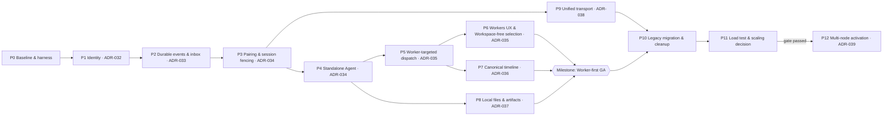

# Worker-first: Implementation Phases (ADR-032 → ADR-039)

- **Status:** Proposed plan
- **Date:** 2026-11-19
- **Replaces:** the phase ordering in `WORKER_FIRST_MIGRATION_AND_SCALING_PLAN.md`. Its data-migration map, verification matrix and rollback principles still apply.

## Ordering principles

1. **Identity first, durability second, product third, transport and scaling last.** Each milestone ships to users and is useful on its own.
2. **One server until load proves otherwise.** Every phase must keep the multi-server-safe rules from ADR-033: state committed in PostgreSQL, no correctness held in process memory. Running more than one node in production is gated by ADR-039.
3. **One execution path per assignment.** The old Workspace path and the new Worker path never run the same work. Old and new *reads* can be compared side by side.
4. **Additive schema changes first.** Destructive changes come only in the final cleanup phase, after the rollback window.
5. Each phase lists its ADRs, dependencies, tasks and **exit gate**. Phases on separate lines (marked ∥) can run in parallel.

## Dependency graph

**Minimum path to a first usable version:** P0 → P1 → P2 → P3 → P4 → P5 → P6, on one server, with Agents connected through the compatibility adapter.

---

## P0: Baseline, inventory and test harness

**ADRs:** all. **Depends on:** ratification of ADR-032 to ADR-039.

- Mark ADR-031 as *Split* with links to its replacements. Link superseded sections in ADR-012/013/014/029 and the Workspaces UX contract.
- Inventory every route, table and foreign key that uses `execution_workspaces`, `workspace_*`, `worker_assignments.execution_workspace_id`/`runtime_identity_id`, `worker_activity_history.workspace_id` and `thread_work_configs`.
- Inventory the Workspace Service features the Agent must inherit: registration, readiness, Engine, Profiles, journal, MCP, plugins, allowed folders, services on all three OSes, updates.
- Set up a real-PostgreSQL integration test environment, a fake provider Engine, and a **two-Bun-process CI job** (it is used from P2 on to guard the multi-server rules).
- Capture baseline metrics: idle sockets, message latency, memory. Run a backup and restore exercise.
- Feature flags: `worker_identity`, `worker_agent_connect`, `worker_target_dispatch`, `workers_ux`, `canonical_timeline`, `artifact_handoff`, `unified_gateway`, `cluster_mode`.

**Exit gate:** the inventory is complete, the harness is green and backups are verified.

**Status (2026-11-19): implemented, exit gate open.**

| Task | State | Where |
| --- | --- | --- |
| ADR-031 *Split*; supersession links in ADR-012/013/014/029 and the Workspaces UX contract | Done | the five documents carry a note at the top |
| Inventory of tables, foreign keys, routes | Done, generated snapshot; regenerate with `node apps/backend/scripts/worker-first-inventory.mjs --write` (`--check` reports drift) | [`WORKER_FIRST_P0_INVENTORY.md`](WORKER_FIRST_P0_INVENTORY.md) |
| Inventory of Workspace Service features for the Agent | Done; also corrects the stale extraction map in `WORKER_AGENT_RUNTIME_V1.md` | [`WORKER_FIRST_P0_AGENT_INHERITANCE.md`](WORKER_FIRST_P0_AGENT_INHERITANCE.md) |
| Real-PostgreSQL tests | Already existed (one database per test file); run locally with `scripts/test-all.sh` | `scripts/test-backend.sh` |
| Fake provider Engine | Already existed at protocol level: `FakeWorkspace` with `completeWith` in `apps/backend/scripts/lib/clients.ts`; Dart fakes in `apps/workspace/test/support` | |
| Two-Bun-process test | Local script, **not yet run**; realtime across nodes is a reported known gap until ADR-038/039 | `scripts/test-two-node.sh`, `apps/backend/scripts/two-node.ts` |
| Baseline metrics | Script written, **no run recorded** | `apps/backend/scripts/baseline.ts`, [`WORKER_FIRST_BASELINE.md`](../operations/WORKER_FIRST_BASELINE.md) |
| Backup and restore exercise | `restore-test.sh` fixed (it checked tables that no longer exist); **exercise not run** | [`WORKER_FIRST_BASELINE.md`](../operations/WORKER_FIRST_BASELINE.md) |
| Feature flags | Done: eight flags with prerequisites, validated at boot | `apps/backend/src/feature-flags.ts`, [`FEATURE_FLAGS.md`](../operations/FEATURE_FLAGS.md) |

Open before the gate closes: run the backend suite and `bun scripts/two-node.ts` against local PostgreSQL, record a baseline run, and run the restore exercise.

## P1: Worker Instance and Actor identity (ADR-032)

- Migration: `actors`, `worker_instances`, `legacy_worker_mapping`. Backfill human Actors and Instances from `workspace_worker_inventory`.
- Add a nullable `worker_instance_id` to `worker_assignments`, `worker_activity_history` and Thread/Workflow configuration (no NOT NULL changes yet).
- `/api/workers` CRUD, owner-only. Separate `enabled`, `online` and `ready` fields.
- Shared DTOs in `packages/protocol`. Worker model in Flutter (read-only list behind `worker_identity`).
- Tests: two Workers with the same name and Type; ownership enforcement; rename keeps the ID; tombstoning.

**Exit gate:** Workers can be managed independently of Workspaces, and the backfill counts and referential integrity check out.

## P2: Durable events, outbox and command inbox (ADR-033)

- Widen the `stream_kind` CHECK (`thread`, `worker_inbox`, `assignment`). Add `outbox` and `agent_commands`.
- Write the domain change, sequence, event and outbox in a single transaction, with exactly one stream per event. Document which events go to which stream.
- Outbox dispatcher (`SKIP LOCKED`, retries, gap sweep) waking the local gateway.
- Fix cursor semantics: `lastEnqueuedSequence` is separate from the applied acknowledgement. Stop writing cursors to the database on every event.
- Bounded queues per socket (bytes and items), Bun `drain` handling, `sync.required` on overflow, coalescing of ephemeral events.
- Wrap the existing Workspace assignment delivery so commands go through `agent_commands`.

**Exit gate:** killing the process between commit and send loses nothing. Concurrent writers to one stream produce gap-free sequences. A slow client keeps memory bounded. The two-process test (`scripts/test-two-node.sh`) passes.

## P3: Worker pairing, credentials and session fencing (ADR-034, server side)

- Endpoints: create a pairing challenge, claim it with the Agent's public key, rotate, revoke, transfer. Audit records for each.
- Authentication with a signed nonce. `worker_agent_sessions` with an epoch that increments atomically on connect and a lease.
- Epoch and attempt checks inside every acknowledgement and terminal-result write.
- Compatibility adapter: Worker principals connect through the existing Workspace gateway, but each with its own identity.
- Heartbeat and lease renewal at a bounded rate. No database write per ping.

**Exit gate:** two logins with the same credential mean the newer one wins and the older one's late result is rejected. Replay, cross-user claims and expired challenges are refused.

## P4: Standalone Worker Agent (ADR-034, client side)

- Extract `syntila-worker` from `apps/workspace`: per-Worker data directory, local lock, key store, durable journal (fsync), Profile cache, readiness checks, Engine supervisor.
- CLI: `install --pairing-code`, `run`, `status`, `logs`, `config`, `permissions`, `rotate-credential`, `uninstall`.
- launchd, systemd and Windows service lifecycle; opt-in auto-start; signed updates. Provider CLI started on demand.
- Reconnect sequence: claim epoch, report journal, reconcile with the server, then start new work.
- "Separate OS user" install option, with the isolation limits documented.
- Test driver with a fake Engine. Run the full crash and reconnect matrix.

**Exit gate:** two Agents with the same Type and name on two hosts run independently. Two Agents on one host keep separate journals. No Engine is ever started twice. It works without a Workspace installed.

## P5: Worker-targeted dispatch (ADR-035)

- `work-creation.ts`: resolve and authorize `worker_id` (owner, enabled, Type and capabilities, Thread execute right) at admission.
- Snapshot at acceptance: Worker, Actor, Type, Profile digest, model, effort, permissions.
- `assignment-dispatcher.ts` routes to the Worker inbox. The Workspace columns become nullable. The legacy path stays behind a flag, with one path per assignment.
- Offline: reject with `worker_offline`. No fallback.
- Workflows with several steps bind a Worker per step and re-check eligibility per step.

**Exit gate:** a Thread → Worker → answer round trip works with parity to the V9 lifecycle. Crashes, retries and cancellation while offline behave correctly. There is no unauthorized execution.

## P6: Workers UX and Workspace-free selection (ADR-035) ∥ P7, P8

- The Workers page replaces Workspaces: add (Type, name, pairing), rename, alias, disable, revoke, remove, status, diagnostics.
- Thread composer: Worker picker built from the server's list of eligible Workers. Duplicate names are told apart by Type, alias, status and a short ID suffix. Selections are saved by ID.
- Remove Workspace selectors and grants from the Space and Workflow editors. Saved configurations migrate to Worker IDs, and invalid ones show a clear error.
- Status UX for offline, not ready, revoked during a run, and retry or cancel.

**Exit gate:** a new user adds a Worker and asks from a Thread without ever seeing a Workspace.

**Implementation in progress:** With `worker_target_dispatch` enabled, Worker
list connectivity is based on the Agent session lease used by admission,
instead of the legacy Workspace session. Agent readiness is not yet reported
to the server, so the existing boolean `ready` remains false on this path; it
must not be interpreted as a diagnosed readiness failure. The Workers page,
eligible picker, configuration migration, and status flows remain open. The
exit gate has not been demonstrated. The existing Worker-targeted admission
also rejects stateful Workflows, including Work; it does not yet implement the
full per-step Worker path described in P5.

The existing Worker Instance section now offers creation from the active Type
catalog, pairing, renaming, alias editing (stored as the existing description),
enable/disable, credential revocation, and removal when `workers_ux` is enabled.
It is still embedded in Workspaces; a standalone Workers page and the
Workspace-free path are not yet implemented. Pairing alone does not overcome
the P4 trusted Profile delivery gap.

## P7: Canonical timeline and attribution (ADR-036) ∥ P6, P8

- Add `author_actor_id`, `worker_instance_id` and `author_display_snapshot` to `discussion_messages`. Backfill.
- Partial unique indexes: one `ai_request` and one `ai_answer` per Work Request. Mutation receipts for human sends.
- The terminal transaction commits the result, the `ai_answer` and the event together.
- The Workflow terminal-step rule for authorship, with a System Actor as fallback.
- Paginated timeline API. Flutter renders one timeline. Compare old and new rendering on fixtures, then remove the client merge.

**Exit gate:** no duplicate answers under replay, no missing historical Work cards, correct attribution after rename or delete.

## P8: Local files and artifact handoff (ADR-037) ∥ P6, P7

- Move Allowed Folders protections and the Work Root/Space mapping into the Agent. Migrate existing roots through explicit mapping.
- R2 artifact service: upload with checksum and limits, metadata, scoped expiring downloads, retention.
- Workflow steps reference artifact IDs or Git references. Path-based handoffs are rejected.

**Exit gate:** a macOS → Linux Workflow hands off an artifact correctly, and folders that weren't approved can't be reached.

### Milestone M1: Worker-first GA (one server)

Turn on `worker_agent_connect`, `worker_target_dispatch`, `workers_ux`, `canonical_timeline` and `artifact_handoff` by cohort: internal, then owners, then a test cohort, then default.

## P9: Unified realtime transport (ADR-038) (can start after P3, in parallel with P5–P8)

- Gateway layers: Transport, then SubscriptionRegistry, then Replay/Publisher, then Command inbox. Remove Durable Object concepts from the core.
- `syntila.messaging/1` envelope. Human ticket authentication and Worker key authentication, with separate scopes and rate limits.
- Subscription bootstrap without races. Subscriptions invalidated immediately when access is revoked.
- Agents move from the compatibility adapter to the unified gateway. Old Workspace frames go through the bridge only.

**Exit gate:** humans and Workers use one gateway. The behavior parity suite is green. The bridge is the only legacy code left.

## P10: Legacy migration and cleanup

- Local conversion tool: legacy Workspace → one Agent per Worker, keeping IDs, Profiles, Work Roots and native sessions where it is safe.
- Stop new Workspace registrations. Let legacy assignments finish. Turn off the Workspace gateway.
- Make `worker_instance_id` NOT NULL on new rows. Drop the Workspace grant, selection and session paths, the compatibility bridge and obsolete tables, **after** the rollback window. Archive the identity mapping.
- Update onboarding, support docs and release notes. Mark the old docs as superseded.

**Exit gate:** no new Work depends on a Workspace, nothing is lost in migration, and a rollback rehearsal is documented.

## P11: Load testing, hardening and the scaling decision

- Load scenarios: 1,000 and 5,000 idle sockets, 500 active senders, 100 to 1,000 Agents at 1–2 events per second, 50 streams, slow readers, reconnect storms, a 24-hour soak.
- Metrics: idle memory per Agent, lease writes per second, outbox age, delay from commit to delivery, acknowledgement lag, DB locks and top queries, event-loop lag.
- Security review: tickets, Worker keys, session fencing, rate limits, abuse budgets.
- **Decision record:** whether one node meets the ADR-039 targets. If yes, P12 is deferred and the two-node test keeps guarding the rules.

## P12: Multi-node activation (ADR-039), only when the gate is met

- `LISTEN/NOTIFY` listener per node, a node-local subscription index, a Worker session directory with close notifications to the old node.
- Move all in-process coordinators, timers and cron jobs to PostgreSQL leases with fencing. Recovery jobs are claimed, not run on every node.
- Caddy load balancing, liveness and readiness checks, graceful drain, rolling deploys, a Postgres connection budget per node.
- Failure injection at every assignment transition, across nodes.

**Exit gate:** measure 1, 2 and 3 nodes. Killing a node causes no duplicate provider runs and no fabricated results. A rolling deploy is verified.

---

## Traceability: ADRs to phases

| ADR | Phases |
| --- | --- |
| 032 Identity | P1 (+ P10 cleanup) |
| 033 Durable events / inbox | P2 (+ P12 cross-server wakeups) |
| 034 Agent / fencing | P3, P4 |
| 035 Worker-targeted execution / UX | P5, P6 |
| 036 Canonical timeline | P7 |
| 037 Files / artifacts | P8 |
| 038 Unified transport | P9 |
| 039 Horizontal scaling | P11 decision, P12 |

## P1 status (implementation in progress; deployment gate open)

- Migration `0026_worker_instances.sql`: `actors`, `worker_instances`, `legacy_worker_mapping`, trigger-maintained Actors, inventory adoption/backfill, nullable `worker_instance_id` on assignments, activity history, Thread and Workflow configuration.
- `/api/workers` CRUD (owner-only, flag `worker_identity`), `/api/features`; the old Workspace inventory list moved to `/api/workspace-workers`.
- Protocol: `packages/protocol/src/worker-instance.ts`, `packages/dart/protocol/lib/worker_instance.dart`; app: `AxSessionCatalogs.workerInstances`.
- Tests: `apps/backend/test/domain/worker-instances.test.ts`, `packages/dart/protocol/test/worker_instance_test.dart`.
- A read-only Worker Instance list appears in Workspaces when `worker_identity` is enabled. It distinguishes configured enablement, connectivity and observed readiness. On the standalone Agent path readiness is explicitly unknown until the Agent can report a complete readiness assessment; `ready: false` alone must not be interpreted as a failed check. The additive `readinessKnown` response field makes this distinction.
- For deployment data, run `psql -X -v ON_ERROR_STOP=1 "$DATABASE_URL" -f apps/backend/scripts/check-worker-identity.sql` with a read-only database role. Investigate every nonzero violation and record the counts. The audit does not change data and recognizes intentionally retained tombstone mappings. Fixture evidence is not a substitute for this deployment-specific gate.
- Remaining: implement complete standalone Agent readiness reporting after Profile verification is available, and run the audit on each deployment's data. The fixture tests do not close the deployment gate.

## P2 status (implementation in progress)

- Migration `0027`: wider `stream_kind` CHECK, `outbox`, `agent_commands` (trigger-driven status), `realtime_events(occurred_at)` index.
- One transaction for domain change, sequence, event and outbox row; inline delivery plus `OutboxDispatcher` (retries, dead rows, sweep with gap report and command expiry).
- Gateway: `lastEnqueuedSequences` apart from `appliedSequences` (hello and the new `ack` message); no cursor writes to storage; byte and item bounds; Bun `drain`; one `reconnect.required` per overflow and no more frames until the client's hello. Fixed: the non-gap path advanced the cursor for refused frames.
- Assignment dispatch writes the `agent_commands` row with the command payload before delivery.
- Tests: `durable-outbox.test.ts`, `realtime-backpressure.test.ts`, an assertion in `assignment-selection-snapshot.test.ts`, the rewritten hibernation test; `scripts/two-node.ts` check 5 kills a node mid-write.
- Workspace-backed assignment gateway and dispatch phase events, including bulk escalation of unconfirmed revocations, now commit with their associated mutation and outbox entry, with rollback coverage. Other recovery/bulk queue writers and Workspace-free Worker phase events still need an atomic event path; the latter needs the execution event stream contract. Cross-node live wakeups remain explicitly deferred to ADR-039 and the `sync.required` wire rename to ADR-038.
- Local two-process harness (2026-11-20): crash/outbox recovery and invariant checks passed; cross-node realtime fan-out remained a reported gap. This is not strict-mode or production deployment evidence.
- Run: `bun scripts/write-paths.ts --write`, `bun run schema:lock` (see P1 notes), `scripts/test-backend.sh`, `scripts/test-two-node.sh`.

## P3 status (implementation and local integration evidence)

- Migration `0028`: `worker_pairing_challenges`, `worker_credentials`, `worker_auth_nonces`, `worker_agent_sessions` (one row per Worker, epoch), `worker_audit_log`; a trigger closes the credential and session of a removed Worker.
- `worker-agents.ts`: pairing, transfer, rotate, revoke, signed-nonce login, atomic epoch bump, `AgentLeaseKeeper`; `agent-session-fence.ts`: the fence used inside `transitionAssignment`, `recordAssignmentResult`, `recordAssignmentError`, `recordAssignmentCancelled`.
- Routes: `/api/workers/:id/pairing|transfer|credential` (owner), `/api/worker-agent/claim|nonce|sessions|rotate` (Agent). Request schemas in `@syntila/protocol`.
- Gateway adapter behind `worker_agent_connect` (Worker principal and fence per Agent, the Workspace runtime id only as correlation id, message allowlist, lease renewal on heartbeat, stale sessions closed). Lapsed leases are closed by the outbox sweep.
- Tests: `test/domain/worker-agents.test.ts` covers stale cancellation and permits and a concurrent session replacement. `test/domain/worker-agent-live.test.ts` runs the Dart Agent against a real local backend through the Workspace compatibility WebSocket and exercises pairing, signed login, hello and reconciliation. It does not cover standalone dispatch or a provider run.
- Run: `bun run schema:lock` (scratch database, see P1/P2 notes), `bun scripts/write-paths.ts --write`, `bun run routes`, `scripts/test-backend.sh`, `scripts/test-two-node.sh`.

## P4 status (implementation in progress)

- New pure-Dart package `apps/worker_agent` (`syntila-worker`); it does not import `apps/workspace`. Details and limits: [`WORKER_AGENT_CLI_AND_SERVICES.md`](../specifications/WORKER_AGENT_CLI_AND_SERVICES.md).
- Done: per-Worker data directory, local lock, Ed25519 key store, fsync journal, Profile cache, readiness checks, allowed folders, Engine supervisor (slots, never twice), CLI (`install --pairing-code`, `run`, `status`, `logs`, `config`, `permissions`, `rotate-credential`, `update stage`, `uninstall`), launchd/systemd/Task Scheduler adapters with opt-in auto-start, separate-OS-user plan, signed update check, reconnect sequence.
- Tests: fake cloud (pairing, signed nonces, epoch fence, command inbox), fake Engine, crash matrix over every journal write point, two Agents on two hosts, two Agents on one host, no-Workspace check.
- `CliEngineLauncher` has a controlled-provider test against the real generic Engine, consumes the server's nested snapshot, and reports provider start only on Engine evidence. The real Agent also pairs and reconciles over the Worker gateway without a Workspace row. Those are separate tests, not an end-to-end provider run.
- The Agent Profile cache retains its admission proof and rechecks current trust on every read. Older cache entries without a proof are rejected; the CLI remains fail-closed until signed publication and trust roots are implemented.
- **Not done:** trusted Profile download and verification, platform secret store, readiness/inventory publication, binary swap for updates, Windows separate-user setup and real-platform service evidence. `run` without an Engine or a verified cached pinned Profile fails closed. Complete crash/reconnect and two-host evidence with real Agents and Engine processes is still needed before the exit gate closes.

## P5 status (in progress; exit gate open)

Built (ADR-035):
- Admission (`work-creation.ts`, `worker-eligibility.ts`): `worker_id` is resolved and authorized (owner, enabled, Thread Type policy, Thread execute right, and permissions required by known Workflow capabilities). Unknown capabilities are rejected. The catalog does not yet provide per-Type capability declarations, so Type capability support is not verified. The acceptance snapshot (Worker, Actor, Type, Profile digest, model, effort, permissions) is frozen on the task. Worker-targeted preflight uses the same binding eligibility checks; unknown step binding keys are rejected.
- Dispatch (`assignment-dispatcher.ts`, `worker-dispatch.ts`): a task with a Worker target takes the Worker path; otherwise the legacy Workspace path. One path per assignment, enforced by a CHECK (`migrations/0029_worker_targeted_dispatch.sql`; Workspace columns are nullable). The Worker path is behind `worker_target_dispatch`. No live Agent session means the assignment is rejected with `worker_offline`; there is no fallback.
- Per-step binding: workflows bind a Worker per step; eligibility is re-checked on each step and on retry (`worker-target-bindings.ts`, `work-lifecycle.ts`).
- Worker-keyed gateway (`worker-gateway.ts`, route `GET /api/worker-agent/gateway`): one Durable Object per Worker (`worker:<id>`), speaking the Agent side of the wire protocol with the Agent session fence on every write (hello, heartbeat, sync, ack, start permit, start ack, result, error, cancelled, cancel ack). The envelope workspace fields carry `worker:<id>` as a correlation token only.
- Revocation, recovery and cancel route by `execution_path` (`assignment-revocation.ts`, `recoverStaleAssignments`, `cancelTaskAssignment`). An Agent offline past 30 s fails its in-flight assignments; revocations are resent on reconnect sync.

Known limits: stateless workflows only (stateful needs a Primary Workspace); files and tool calls are rejected on this path (P8); no plugin Types; models and efforts are not validated against a Profile catalog; Agent durable-session recovery has not been proven; `assignment-liveness` and Workspace delivery stay Workspace-scoped and never touch Worker rows.

PostgreSQL-backed eligibility tests cover ownership, frozen identity and Profile, disabled/offline Workers, Thread policy, required permissions, unknown capabilities, retry rechecks, and invalid binding keys. These tests do not prove the end-to-end exit gate. Trusted Profile delivery and verification (P4), per-Type capability declarations, Worker execution phase events, and real Agent-to-Engine lifecycle, crash, retry, cancellation and authorization evidence remain necessary. Point the Agent `gatewayUrl` at `/api/worker-agent/gateway` with `workerId` and `workerSessionId` query parameters.
