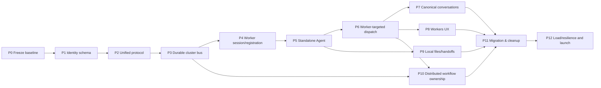

# Worker-first Architecture + Horizontal Scaling — Implementation Roadmap

**Status:** Proposed engineering plan; no code changes made.  
**Prepared:** 2026-11-19.  
**Starting point:** Bun/PostgreSQL port of existing Syntila domains; Flutter app; headless Dart Workspace Service and generic CLI Worker Engine.  
**Target:** Production-capable Worker-first architecture with one WSS connection per Worker Instance, unified human/Worker transport, direct Worker selection and safe multi-Bun-node operation.

## 0. Scope and delivery strategy

This is a **large coordinated refactor**; optimize for safe incremental delivery rather than a one-shot rewrite. Implement horizontal scaling as a first-class acceptance gate of the new transport — do **not** leave it as an unspecified post-migration phase. Distinguish:

1. **Distributed realtime**: N Bun nodes, local socket subscriptions, PostgreSQL-backed durable event log and recovery, node-to-node wakeups.
2. **Distributed Worker sessions**: one current authenticated Worker Agent session per Worker Instance, with epoch fencing and reconnect anywhere.
3. **Distributed execution**: N schedulers/Workflow workers cannot duplicate logical assignment start/cancel/terminal state. DB leases/conditional transitions enforce ownership.
4. **Human/AI user experience**: no Workspace selection/grants, all eligible Workers displayed in Thread composer, unified conversation timeline, local files not accidentally shared.

Ship these as integrated vertical slices and then decommission old Workspace gates only after acceptance. Do not freeze old code until Bun/Postgres target is stable enough to test these slices. The system may remain on one physical server during development, but **two independent Bun processes** must be exercised early using the same PostgreSQL database.

## 1. Implementation principles and critical invariants

- **IDs not names:** duplicate Worker names allowed; Worker Type and immutable Worker Instance ID separate. Display name never used in binding, routing or security.
- **One connection per Worker:** independent machine credential, session epoch, local Agent journal and WSS; no shared Workspace multiplex, even for multiple Agents on same host.
- **Worker without Workspace:** standalone installation must be functional without manager or Cloud Workspace resource.
- **Authorization:** owner's Worker + Thread `execute` right by default; additional grant explicit and scoped. Worker cannot impersonate human or browse unrelated Threads.
- **Durable before notify:** conversation message/Work Request, event/outbox and assignment command state persisted first; WebSocket frames recoverable.
- **Idempotent outcome:** at-least-once delivery with immutable IDs, conditional transition and deterministic final answer projection.
- **Local authority:** signed Profile, Engine security, provider credentials, Work Roots, allowed folders and local cancellation remain locally enforced.
- **One writable database region:** horizontal node cluster first; global active-active not attempted.
- **Feature flags:** `messaging_unified`, `worker_agent_connect`, `worker_target_dispatch`, `thread_worker_picker`, `canonical_message_projection`, `cluster_outbox`, etc. Use flags to enable entire compatible paths, not half of a transaction.

## 2. Workstreams and dependencies

Phase numbers are **dependency sequence**, not elapsed weeks. Some phases can proceed in parallel behind tests; for example, Worker Agent package extraction can begin while protocol gateway is built, using contract mocks.

## Phase 0 — Contract ratification, inventory and baseline

**Goal:** Stop architecture drift and establish migration safety before touching the 97-table PostgreSQL baseline (observed in `apps/backend/migrations/0001_initial.sql`).

### Tasks

1. Ratify ADR-031 and these proposal documents. Record policies: offline Worker queue versus immediate reject, sharing defaults, Worker deletion, model selection and historical attribution.
2. Verify Bun/PostgreSQL port state and all existing automated tests. Capture commit SHA, database schema checksum, active migrations, current Worker/Space/Thread data, release build versions and known failing tests.
3. Inventory every route/table/FK/constraint relying on `execution_workspaces`, `workspace_runtime_identities`, `workspace_worker_inventory`, `workspace_space_grants`, `workspace_worker_preferences`, `workspace_allowed_folders`, `workspace_sessions`, `worker_assignments.execution_workspace_id`, `worker_activity_history.workspace_id`, `thread_work_configs`, `conversation_turns` and `conversation_history_entries`.
4. Inventory frontend Workspaces UX, Space Workflow configuration, Thread composer, Worker selection, permission gates, history merge code and persistence.
5. Inventory Workspace CLI/Service features that must transfer to Worker Agent: registration, readiness, generic Engine, Profiles, provider sessions, journal, MCP, plugins, allowed folders, installation updates, diagnostics, Windows/macOS/Linux services.
6. Add a disposable real-PostgreSQL integration test environment and two independent Bun processes with fixed port addresses; set up fault injection and test fixtures. Record baseline 1k idle sockets, 100 concurrent messaging users and synthetic activity.
7. Take verified DB and user-work-directory backups, including a restore exercise before schema evolution. Distinguish nonproduction fresh-reset capability from preserving valued current user/test data.

**Deliverables:** dependency inventory, before/after contract matrix, test baseline, backup/restore report, feature flag design.

**Exit gate:** all canonical invariants agreed; two-node test harness available; no unknown authoritative data sources.

## Phase 1 — Worker Actor and schema foundation

**Goal:** Make Worker Instance the durable identity without immediately switching execution transport.

### Tasks

1. Introduce `actors` (`actor_id`, `actor_kind`, immutable human/worker binding, tombstone metadata), `worker_instances` (`worker_id`, `actor_id`, `owner_user_id`, `worker_type_id`, nonunique name, description, enabled, timestamps, configurable defaults) and per-Agent registration/credential tables.
2. Add Worker readiness/presence projection and `worker_agent_sessions` with unique current `worker_id`, session epoch and lease expiry; presence and readiness remain separate fields.
3. Add optional `worker_sharing_grants` data model even if feature remains disabled; set owner-only access as v1 default.
4. Preserve existing Worker Type and signed Profile definitions, `worker_catalog`, `worker_profiles` and `worker_profile_history`. Do not fork Profiles per Worker Instance.
5. Create migration mapping from legacy `workspace_worker_inventory.worker_id` to Worker Instance ID **where IDs can be preserved**; freeze ownership/type/label/profile data for historical references. Where old identifiers cannot be reused, create explicit immutable mapping table and backfill FKs/projections with verified referential integrity.
6. Add DB migrations additively: new nullable `worker_instance_id` references on assignments/turns/grants where needed. Do not immediately drop NOT NULL Workspace FKs or modify historical records until new route is tested.
7. Add Worker CRUD endpoints and server-side eligibility service that checks owner, status, Thread execute permission and type capabilities.
8. Enforce duplicate names in tests: two same-owner/same-name/same-type Workers are valid; IDs and bindings never collide.

**Code areas:** new migration(s), `apps/backend/src/domain/routes/*workers*`, `assignment-dispatcher.ts` compatibility projection, `packages/protocol` shared identity DTOs, `apps/app` Worker state model.

**Exit gate:** API can create/list/rename/revoke Workers independently of Workspaces, ownership enforced; historical IDs remain navigable.

## Phase 2 — Unified messaging protocol and gateway (single node)

**Goal:** Replace two transport interfaces with one reusable human/Worker transport core before adding cluster routing.

### Tasks

1. Implement versioned shared envelope (`syntila.messaging/1`), Actor principal binding, scope authorization, subscribe/unsubscribe, heartbeat, ack, resume, error and capability negotiation.
2. Separate `TransportConnection` (socket/queue/auth/metrics), `SubscriptionRegistry`, `DurableReplay`, `EventPublisher`, `WorkerCommandInbox` and domain handlers from old Durable Object class concepts.
3. Create human token/ticket authenticator and Worker credential authenticator on the same gateway, with independent permission policies.
4. Keep current Human route semantics through adapter; preserve idempotency, Discussion events and full HTTP state recovery.
5. Preserve Worker runtime command payload semantics using an adapter to existing Workspace protocol until Agent migration. New Worker command and execution evidence must remain **different domain messages**, even if both traverse shared socket.
6. Implement bounded queue by bytes + items, Bun `send()` status/`drain` handling, per-connection priorities, ephemeral coalescing, dead socket cleanup and graceful `sync.required` overflow.
7. Client cursor means last **applied** durable event; server never equates enqueued frame with applied event. Add client ack and race-safe subscribe/snapshot bootstrap.
8. Stop persistence of every connection cursor on each event. Keep active state in memory and rely on client cursors + durable log for recovery.

**Code areas:** `apps/backend/src/domain/realtime-gateway.ts`, `realtime-queue.ts`, `event-publisher.ts`, `platform/durable-objects.ts`, `runtime.ts`, `server.ts`; `packages/protocol/src/realtime-events.ts`; Flutter realtime client.

**Exit gate:** same single-node human chat behavior and new Worker-oriented protocol integration tests; slow socket memory remains bounded and persistent events recover.

## Phase 3 — Horizontal realtime delivery and outbox (two-node gate)

**Goal:** Prove shared messaging works across two Bun instances **before** Worker Agent cutover.

### Tasks

1. Introduce transactional outbox alongside authoritative per-stream durable event rows and sequence allocator; ensure one DB transaction includes message mutation, stream counter, event and outbox.
2. Keep/align existing `realtime_events` and `realtime_event_cursors` rather than introducing a competing log unintentionally. Extend stream identity to `thread`, `worker_inbox` and/or reuse `space` as appropriate with a single migration strategy. Verify migration constraints, indexes, replay query plan and retention.
3. Use PostgreSQL `LISTEN/NOTIFY` as a **wakeup** in first implementation, not durable transport. Run dedicated listener connection per node and bounded notification handler, plus outbox dispatcher and periodic gap sweeper. Publish event IDs/stream heads only, not sensitive full content.
4. Build node-local subscription maps keyed by authorized Actor/Thread and active connection, with batching and membership invalidation. Avoid per-socket SQL authorization on every event; immediately invalidate on permission revocation.
5. Add outbox claim/retry using `FOR UPDATE SKIP LOCKED` or equivalent transactional claim; pending records survive publisher crash. Duplicate notifications may happen, dedupe by event ID + sequence. Ensure durable event commit order and stream sequence allocation remain monotonic under concurrent writers.
6. Implement multi-node subscription authorization, replay, HTTP rebase and last-applied ack, including notification-loss recovery.
7. Run two real Bun processes against one PostgreSQL, with deterministic socket placement and forced node termination. Confirm durable and ephemeral cross-node messages, no permanent divergence.

**Code areas:** new outbox and cluster bus modules/migrations; `event-publisher.ts`, `realtime-gateway.ts`, `realtime-retention.ts`; `server.ts` lifecycle; new two-process integration tests.

**Exit gate:** Human A on node 1 and Human B on node 2 see one logical message; kill either node at commit/delivery points, both recover state. This is a **mandatory horizontal scaling acceptance gate**, not a future enhancement.

## Phase 4 — Per-Worker authentication, pairing and distributed session fencing

**Goal:** Any Bun node can authenticate any Worker and guarantee one active Agent session per Worker Instance.

### Tasks

1. Implement one-time owner-approved Worker pairing with expiring nonce, credential digest storage and secure Agent credential return. Add rotate/revoke/transfer endpoint and server audit records.
2. Implement machine principal verification bound to exact Worker Instance, current owner and enabled state, not to a Workspace Runtime identity.
3. Atomic session claim increments worker `session_epoch`; store current node and lease. New session fences old; stale old-session commands/results rejected despite delayed socket closure.
4. Heartbeat and lease renewal at bounded cadence, not per event. Distinguish connection presence, Worker readiness and active assignment state. Reconnect with jitter, sync before accepting new work.
5. Implement durable Worker inbox read/list/ack/reconcile APIs and cross-node wakeups. An offline Worker has persisted command intent (policy-dependent), not a phantom queued socket frame.
6. Load/race tests: two simultaneous logins with same credentials, node crash, expired lease, credential revocation, transfer to new host, delayed old terminal event.

**Code areas:** new auth/Worker registration modules, Worker session directory, gateway, `assignment-delivery.ts`, `apps/backend/src/domain/routes/workspaces-registration.ts` legacy adapter.

**Exit gate:** Worker reconnects to different Bun node with a higher epoch; old session is fenced; no Worker/owner leakage; registry is independent from computer name.

## Phase 5 — Extract standalone Worker Agent runtime

**Goal:** Run one independently connectable Agent per Worker Instance, without installing Syntila Workspace.

### Tasks

1. Extract/refactor headless Dart service into `syntila-worker` Agent package with a per-Worker local directory, OS-level installation lock, credential manager, journal, shared transport client, Profile cache, readiness service and CLI Engine supervisor.
2. Reuse existing `syntila-agent` generic Engine and signed Profiles. Profile/Type defines provider CLI, models, icon and capabilities. No provider-specific standalone binary requirement.
3. Ensure each Agent has exactly one direct backend WSS, not a manager relay. Different Agents on same machine have separate credentials/queues/local journals and may be started/stopped independently.
4. Implement single-use pairing, worker status, start/stop/restart, logs, config, allowed folders, rotate/revoke and uninstall commands; secure IPC/local OS service control.
5. Port macOS launchd, Linux systemd and Windows service lifecycle. Add opt-in auto-start and update verification. Do not keep provider CLI permanently running while idle.
6. Port execution readiness, Engine/profile signature verification, provider auth probe, concurrency, cancellation, local journals, saved provider sessions, MCP/plugin constraints, process cleanup and diagnostics.
7. Add a `Worker Agent` test driver with fake provider Engine for deterministic command/terminal/reconnect testing.

**Code areas:** existing `apps/workspace` modules, `apps/workspace/lib/workspace_runtime.dart`, `cli_worker_engine_supervisor.dart`, `assignment_journal.dart`, service lifecycle and CLI; new package/name as agreed.

**Exit gate:** install two Workers with same name/type on different machines; each connects directly using own credential and processes distinct assignment safely. Standalone Agent works without Workspace Manager.

## Phase 6 — Worker-targeted scheduling and execution

**Goal:** Work Request routing and terminal result authority no longer depend on `execution_workspace_id` or Workspace grants.

### Tasks

1. Resolve `worker_id` directly from explicit Ask AI choice, personal/default Workflow configuration or step binding; enforce Thread execute right, Worker ownership/grant, enabled/readiness/type/model/effort/permissions before acceptance.
2. Change assignment destination to Worker Instance, preserving immutable accepted snapshot: Worker Actor/Type, Profile digest/revision, model, effort, permissions, owner, attempt ID, deadlines and session/context reference.
3. Add `agent_commands` durable Worker inbox for start/cancel/control, with unique command identity and expiry; claim/deliver through Agent current session, not a Workspace gateway.
4. Preserve assignment `created` → `dispatched` → admission ack → `running` evidence → terminal transitions, revocation pending, start permit and attempt fencing. Distinguish delivery to gateway from Agent durable acceptance.
5. Refactor `assignment-dispatcher.ts`, `workspace-gateway.ts` and workflow coordinator to Worker ID routing. Keep old Workspace adapter until parity tests pass.
6. Make Worker-targeted authorization independent from Space-to-Workspace grants; evaluate capability grants and local permissions per selected Agent. Do not introduce automatic share rights from Space membership.
7. Validate multi-step Workflows with different Workers on different machines; accepted Worker selection remains stable across reconnect and rename. No silent Worker fallback.
8. Ensure stale/duplicate Agent results are rejected or idempotently acknowledged and do not re-start providers.

**Exit gate:** end-to-end user -> Worker A (node 1) -> server -> frontend (node 2) completes and recovers under retries; execution correctness unchanged from existing V9 lifecycle.

## Phase 7 — Canonical conversation timeline and Worker sender attribution

**Goal:** One consistent Thread message read model for Humans and Worker outputs, while execution metadata remains separate.

### Tasks

1. Decide whether to migrate `discussion_messages` in place or introduce `thread_messages` with a compatibility projection. Account for existing `discussion_messages.author_user_id`, `kind`, `work_request_id`, `conversation_history_entries`, `conversation_user_messages`, `conversation_turns` and Work card merge.
2. Add Actor author reference, immutable sender ID, optional Worker ID and historical display snapshot; preserve human semantics and original IDs/time ordering.
3. On Ask AI acceptance create one canonical user request timeline item linked to Work Request, not a duplicate separate chat item.
4. In **one terminal DB transaction**, persist authoritative assignment/Work result and deterministic final Worker reply message; unique `(work_request_id, response_role)` or equivalent guards retries and duplicate activity. Decide exactly how multi-step Workflows expose the final author when several Workers contribute.
5. Preserve provider session and canonical context revision semantics across Worker switches; do not silently reuse a native session from another Worker/machine. Migration/read model must not truncate past context.
6. Extend HTTP paginated timeline, event ID-only notifications, search/unread/replies as applicable, and Flutter message rendering. Maintain Work cards/Run Details and not allow immutable AI execution evidence to be edited as human Discussion.
7. Dual-render and compare old combined timeline versus new canonical timeline on seeded historical fixtures. Remove old overlay only when completeness verified.

**Exit gate:** human and Worker messages appear in one ordered Thread; no double answer on replay/retry, no missing historical Work cards, correct attribution after rename/deletion.

## Phase 8 — Workers UX and direct per-Thread selection

**Goal:** Remove user confusion and remove the Workspace step from AI onboarding.

### Tasks

1. Replace **Workspaces** page with **Workers**, supporting Worker Type/icon, arbitrary name, optional alias/description, enabled/online/ready state, models, connection/diagnostics, registration/pairing, install guidance, rename/disable/revoke/delete.
2. Remove Space-to-Workspace and Workflow-to-Workspace selector/attachment steps. Remove Workspace grants from normal product flow.
3. Thread composer `Message | Ask AI`: list all owned and explicitly shared eligible Workers regardless of host; display duplicate names with type, status and optional alias; persist selections by Worker ID.
4. Workflow step and defaults editor: bind explicit Worker Instances with model/effort constraints and evaluate ownership/grants on each invocation, not merely at configuration save.
5. Direct/group Threads: owner can use own Workers if Thread execute policy allows; other humans do not inherit Worker execution access. Hide no longer eligible Workers from new selections while preserving historical labels.
6. Status UX: queued/offline/disabled, not-ready explanation, retry/cancel, Worker revoked while Work running, safe reconnect state. Do not imply a Worker can execute just because its name appears in a saved Workflow.
7. Remove Workspace-specific generated display labels and machine identity from normal message sender names. Leave optional user-supplied description only.

**Exit gate:** a new user can add one Worker, connect it and ask from a Thread without ever seeing or setting a Workspace; two identically named Workers remain unambiguous through ID-based selection.

## Phase 9 — Local work and explicit cross-Worker file handoff

**Goal:** Eliminate assumption that Workers participating in one Thread share local directories.

### Tasks

1. Migrate Workspace Work Root / Space directory mapping to per-Worker Agent configuration; preserve existing local folders and identity markers, never delete user files during transition.
2. Port Allowed Folders protections and local permission checks into Agent. Verify privileged paths, symlinks, sandbox behavior, network scope, tool approvals and local ownership.
3. Define capability-scoped artifact transfer: Agent upload to R2, server-side artifact metadata, size/hash, permission/retention, downstream Worker fetch and local safe destination. Multi-Worker Workflow must reference artifact IDs or Git commit/branch, not filesystem paths from the first machine.
4. Context continuity: server canonical conversation turns and artifact refs; local native provider session only for same Worker Instance/session policy. Disable accidental path-only cross-worker handoff and show clear missing artifact errors.
5. Test Worker A on macOS, Worker B on Linux, same Space/Thread; handoff code artifacts; enforce no access to unapproved external directories.

**Exit gate:** cross-machine Workflows are correct and explicit; local files and secrets never leak by assuming shared Workspace state.

## Phase 10 — Distributed Workflow/scheduler ownership and failure recovery

**Goal:** Two or more Bun backend processes may accept requests, schedule, deliver and process results without double execution or stale ownership.

### Tasks

1. Audit all current in-process Durable Object object-name ownership, Thread coordinators, Workflow timers/alarms, DB adapter and scheduled jobs. Extract correctness state from process memory into PostgreSQL.
2. Persist scheduler/Workflow claim and lease/fence on each owned Run/Task/Thread or queue item; use conditional DB updates and `FOR UPDATE SKIP LOCKED` to claim unowned work. Distinguish lease expiry from cancellation and terminal state.
3. Worker command inbox and session epoch checks are authoritative. A stale scheduler must not issue new start permits or finalize a newer attempt. Fencing is validated at DB write and by Agent prior to starting.
4. Periodic recovery tasks (stale assignments, unsignaled terminals, outbox, retention) must be safe under concurrency and not run duplicate mutating work across all nodes. Use DB claim/leases rather than relying on one process running Cron.
5. Reconcile Agent journals after crash, without falsely failing a provider still running. Preserve existing revocation_pending/reconciling semantics and start-permit protections.
6. Exercise crash/failover at each state transition (accepted, queued, dispatched, acked, starting, running, terminal, cancel pending).

**Exit gate:** two active Bun backend nodes and many Worker Agents with cross-node reconnect; no double provider invocation, no fabricated terminal state, no unbounded orphaned tasks.

## Phase 11 — Security hardening, performance and operational controls

**Goal:** Make the distributed architecture safe and economical to operate.

### Tasks

1. Auth review: browser realtime ticket issuance, Worker credential rotation, bearer secrecy, node/Agent impersonation, horizontal session fencing, CORS/origin controls, rate limiting, sharing rights, abuse/cost budgets.
2. Backpressure: byte- and count-bounded queues, Bun `send()` return/`drain`, incremental flush, slow consumer timeout; ephemeral activity coalescing and snapshot repair.
3. Worker activity: distinguish critical terminal, bounded durable lifecycle/tool events and ephemeral statuses; cap per-Agent ingestion, avoid per-event DB reads if trusted assignment cache valid, batch retained history maintenance, rate-limit UI rendering.
4. Database indexes, hot queries and session/outbox/retention cleanup. Run `EXPLAIN (ANALYZE, BUFFERS)` for recipient resolution, Worker eligibility, inbox polling, replay and timeline reads. Set Postgres max connections/pool limits for N nodes.
5. Observability: structured logs and metrics for socket/Worker sessions, queue bytes/age, durable commit-to-delivery, client ack lag, outbox age, reconciliation rate, slow consumers, DB CPU/locks/IO, workflow fences, Worker activity volume and result ack delay.
6. TLS/Caddy load balancing, rolling deployment and health/readiness; graceful connection drain and Agent reconnect jitter. Separate liveness from DB readiness and Worker readiness.
7. Reassess cross-node ephemeral message bus after measured load; start with PostgreSQL notification for durable wakeups; add Valkey/Redis only when justified. Never weaken durable DB recovery.

**Exit gate:** defined metrics; no unbounded memory/query amplification; auth/revocation attack tests pass; restart/rolling deploy verified.

## Phase 12 — System migration, launch and cleanup

**Goal:** Converge on one production path and retire old Workspace-specific product/transport code without losing history or execution evidence.

### Tasks

1. Support one-time local conversion for an existing Workspace installation: list legacy Workers, create/preserve Worker Instances and IDs, export per-Worker configuration and verified Profiles, install one Agent per Worker, establish new credentials, migrate journals/provider native session references safely, preserve Work Roots and local file grants by explicit mapping.
2. Stop new Workspace registrations under flag; allow old Service to finish/settle active assignments and acknowledge terminals before disabling its gateway. Do not revoke actively running processes blindly.
3. Perform database backfill for Actor references, per-Worker target FKs and canonical message projection; verify counts, referential integrity, deterministic IDs, checksum of user/assistant content and history ordering. Preserve immutable audit and completed run records.
4. Enable new backend, Agent and Flutter paths in coordinated stages: internal -> synthetic two-node -> owner accounts -> broader test cohort -> default. Maintain client/protocol compatibility while cohorts coexist.
5. Run dual-path telemetry and migration rehearsals on restored snapshot; stop and rollback on correctness divergence. No destructive drop while rollback still depends on original tables.
6. Remove `execution_workspaces` as a required Cloud execution entity, Workspace-to-Space grant/selection UI, shared Workspace WSS gateway, redundant `workspace_sessions`/runtime auth paths, obsolete preference endpoints and compatibility tables **only after** stable cutover and explicit migration checklist. Preserve archival history/identity mapping and relevant OS manager functionality.
7. Mark old ADR/UX docs as superseded with links to ADR-031; update user onboarding, command help, release notes, support docs, test fixtures and backups.

**Exit gate:** no new Work Requests depend on Workspace ID or grant; all active Workers run with independent credentials/connections; old code removed without lost data; rollback snapshot/restore procedures proven.

## 3. Precise data migration strategy

### Migration map from existing schema

| Current structure | Proposed treatment | Hazard |
| --- | --- | --- |
| `execution_workspaces` | Stop using for new scheduling; retain temporarily as legacy mapping | FK dependencies and historical record visibility |
| `workspace_worker_inventory` | Backfill to `worker_instances` preserving `worker_id` where valid | Type/owner consistency, duplicate name accepted |
| `workspace_runtime_identities`, `workspace_sessions` | Replace with `worker_agent_credentials` and `worker_agent_sessions` | Shared credentials must NOT become Worker credentials |
| `workspace_space_grants`, `workspace_person_grants`, `workspace_member_access` | Remove from normal execution policy; replace only necessary Worker sharing rules | Never accidentally broaden access |
| `workspace_allowed_folders` | Agent-local allowed folders and safe ID summaries | Paths local; no implicit migration across hosts |
| `worker_scheduling` | Re-key to Worker Instance or preserve if stable ID reused | Concurrency/owner assignment |
| `worker_assignments` | Add `worker_instance_id`; preserve old Workspace metadata for historical attempts | Non-null FK and attempt snapshot correctness |
| `worker_activity_history` | Add Worker Instance link / preserve old history | Existing `workspace_id` non-null constraint |
| `discussion_messages` | Add Actor attribution or create `thread_messages` compat projection | Foreign keys, AI archived entries, duplicates |
| `conversations`, `conversation_turns`, `conversation_history_entries` | Preserve context/order/turn semantics; adapt Worker author to Instance | Native provider sessions bound to old runtime |
| `realtime_events`, `realtime_event_cursors` | Evolve to include Thread/Worker inbox streams, preserve sequence guarantees | Composite key/index/retention/commit ordering |
| `thread_work_configs`, user/Space Workflow preferences | Replace Workspace binding with explicit Worker ID selection | Stale saved configs, no unauthorized fallback |
| `worker_catalog`, `worker_profiles`, `worker_profile_history` | Keep type/profile authority | Compatibility with existing Engine and snapshots |

### Safe sequence

- **Expand schema** with new tables/nullable refs and indexes.
- **Backfill** owned Worker inventory and Actor identities; preserve legacy mapping.
- **Dual read and shadow evaluation** for eligibility, conversation views and routing; compare semantics without executing twice.
- **Switch writes** for new Worker Agent sessions and direct Work Requests under feature gates. Exactly one executor path active for a given Worker/assignment.
- **Validate parity** of data and live behavior across nodes.
- **Contract old schema** only when all old clients and in-flight assignments are settled and backups/rollback windows documented.

Never shadow-execute a Work Request through both old and new paths. Shadow reads are fine; duplicate provider invocation is not.

## 4. Cross-cutting verification matrix

| Test | Expected outcome |
| --- | --- |
| Duplicate name+type | Two IDs, two credentials, two connections, two selectable entries |
| Same Worker credential from two computers | New session fences old; no competing assignment effects |
| Human and Worker on different Bun nodes | Routed commands/results visible with no special host config |
| Human A and B in Group Space on different nodes | Shared message delivered once logically; missed notice reconciled |
| Commit then backend crash before fan-out | Message present from HTTP/replay; outbox repaired |
| Two concurrent message writes same stream | Committed sequences monotonic and gap-free within stream |
| Agent crash after admission / before start | Safe journal replay, no double Engine start |
| Agent crash after provider result / before terminal ack | Resend persisted final; one Work answer |
| Cancel while Agent offline | Cancel intent durable; no stale start after reconnect |
| Space membership/Worker grant revoked midstream | New events inaccessible immediately; subscriptions invalidated |
| Slow browser and slow Agent | Queue memory bounded, durable items eventually recovered, ephemeral only dropped |
| Two Workers on unrelated hosts use same Thread | Shared conversation context; local files not presumed shared |
| Multi-step Workflow uses Workers A/B on separate hosts | Explicit artifact/Git handoff; permissions enforced |
| Provider Profile changed during running assignment | Immutable accepted Profile used to completion |
| Worker renamed or deleted | Historical messages retain immutable attribution and safe label |
| Rolling deploy node loss | Worker reconnects elsewhere; no double assignment / repeated final output |

## 5. Performance acceptance (measure, don't assume)

- Reproduce current VPS roadmap target initially: p99 HTTP API <150ms and p99 fan-out <250ms at 2k sockets for a specified realistic workload and defined server. These are *targets*, not current measured facts.
- Scenarios: 1k/5k idle human+Worker sockets, 500 active posters, 100/500/1k simulated Worker Agents with 1–2 activity events/s, 50 AI streams, slow readers, PG listener interruptions, backend reconnection storms, permission revocation, 24-hour soak.
- Zero lost **persistent** content or duplicate logical Worker final messages; ephemeral statuses may drop according to explicit policy.
- Bounded RSS/queue bytes under slow clients; no steady memory growth after hours of reconnects.
- Report per-scenario CPU, RSS, Bun event-loop lag, DB p50/p99/lock wait and top queries, notify queue pressure, outbox latency, client applied-ack lag, fan-out throughput, Worker command delivery and terminal ack time.
- Horizontal capacity scaling is a measured comparative improvement (1 vs 2 vs 3 nodes) for a workload not bottlenecked solely on PostgreSQL; don't claim 2x from connection count alone.

## 6. Rollout, flags and rollback

### Rollout order

1. Schema / audit only; no route behavior changed.
2. Shared human messaging gateway in local/dev with two nodes; existing UI adapters still work.
3. Worker pairing / new Agent canary on a disposable test account; no historical execution migration.
4. Direct Worker scheduling for selected internal Threads; one execution path per Worker.
5. Canonical message projection and Flutter Worker picker; cross-machine workflow/handoff tests.
6. Durable two-node scheduler/Worker session production rehearsal; soak, red-team auth scenarios.
7. Default feature gate on after verified dual-write/reads and snapshot migration; retire old server/Workspace paths after observation window.

### Rollback principles

- Before contracting schema, disable new admissions, drain/stop Worker assignments safely and revert feature flags to old route only for Workers still registered to the old runtime.
- Do **not** hand a new Agent identity back to the legacy Workspace runtime without explicit re-pair/mapping; avoid two owners executing the same Work.
- Preserve old tables/migrations during rollback window; restore DB from verified consistent snapshot only with explicit acceptance of writes lost after snapshot or a documented reconciliation procedure.
- Reverting UI alone does not revert provider execution side effects; rollback must respect active assignment and local process lifecycle.
- A cutover checklist includes outstanding command count, unacknowledged terminal count, outbox age, active old Workspace sessions, grant/permission audit and last processed event sequence per stream.

## 7. Files expected to change / new modules

**Backend:**
- `apps/backend/src/domain/realtime-gateway.ts`, `realtime-queue.ts`, `event-publisher.ts`, `workspace-gateway.ts`, `assignment-dispatcher.ts`, `assignment-delivery.ts`, `routes/work-creation.ts`, user/Space/Thread authorization routes.
- `apps/backend/src/platform/durable-objects.ts`, `runtime.ts`, `server.ts`, Postgres migrations, retention and workflow/coordinator modules.
- New `domain/actors/`, `domain/workers/`, `domain/worker-agent-gateway/`, `domain/messaging/`, `platform/cluster/`, `platform/outbox/` (illustrative package organization).

**Shared protocol:**
- `packages/protocol/src/realtime-events.ts`, `packages/workspace-runtime-protocol/*` compatibility bridge; shared actor principal, message envelope, Worker command schemas.

**Agent:**
- `apps/workspace/lib/workspace_runtime.dart`, Worker Registry, journal, Cloud connection, Engine supervisor, service/CLI packaging; recommended extracted `apps/worker-agent/` or rename `apps/workspace` with build migration rather than duplicate two authoritative runtimes.

**Flutter:**
- `apps/app/lib/src/features/spaces/spaces_pages/thread_page.dart`, realtime cursor client, Work request composer, Space Workflow configuration, Workspaces navigation and backend API models; new `features/workers/`.

**Docs/tests:**
- `docs/decisions/ADR-012`, `ADR-013`, `ADR-014`, `ADR-029`, Work v1, Worker Profile v9, Workspaces UX, Realtime Synchronization; targeted backend, Agent, Flutter unit tests and two-Bun-node integration suites.

## 8. Definition of Done

The migration is complete only when all of the following are true:

- A user installs a Worker on an arbitrary computer, gives it a nonunique name, chooses Type, pairs it and sees it online without creating a Workspace.
- Two equal-named Worker Instances on different computers have independent credentials and current WSS sessions; server routes by immutable Worker ID.
- Thread composer can select any eligible owned Worker without a Space/Workspace binding; shared Workers require explicit grant.
- Human and Worker sockets use the same gateway/protocol/replay/backpressure machinery; Worker commands retain their stronger execution evidence semantics.
- Every durable user message and final Worker answer can be recovered via PostgreSQL regardless of delivery notification loss.
- Two Bun backend instances concurrently support Human messages, Worker assignments, progress, terminal results and reconnects without duplicate logical effects or authorization bypass.
- The generic CLI Engine and signed Profiles continue to work; local filesystem/provider credentials remain protected.
- Agent hosts are not part of server routing logic; optional local Worker Manager is not required.
- Existing conversation, Work Request, immutable history and local user files are preserved or explicitly migrated with verified mapping.
- Performance/resilience tests and rollback rehearsal pass; obsolete Workspace-to-Space and shared Workspace connection paths are retired.

## References

- `docs/roadmaps/VPS_BACKEND_MIGRATION_PLAN.md`
- `docs/architecture/WORKSPACE_ARCHITECTURE.md`
- `docs/specifications/WORK_V1_CONTRACT.md`, `REALTIME_SYNCHRONIZATION.md`, `WORKER_PROFILE_V9.md`, `CONVERSATION_CONTINUITY_V1.md`
- `docs/specifications/COMMAND_DELIVERY_AND_REVOCATION_V9.md`, `EXECUTION_LIFECYCLE_V9.md`
- `apps/backend/migrations/0001_initial.sql`; `apps/backend/src/domain/assignment-dispatcher.ts`, `workspace-gateway.ts`, `event-publisher.ts`, `realtime-gateway.ts`
- Bun WebSocket API: https://bun.com/docs/runtime/http/websockets
- PostgreSQL notifications: https://www.postgresql.org/docs/current/sql-notify.html
