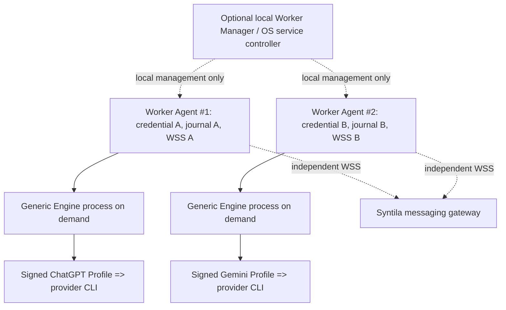

# Standalone Worker Agent Runtime v1

- **Status:** Partly implemented (P4): see `WORKER_AGENT_CLI_AND_SERVICES.md`. The extraction map in section 11 is superseded by it; the Agent is a new package, not a cut of `apps/workspace`.
- **Purpose:** Replace Workspace-as-required-runtime with individually connected Worker Agents while retaining Syntila's existing generic CLI Worker Engine, signed Profiles and durable assignment semantics.
- **Dependencies:** ADR-031; Worker-first Architecture; Unified Messaging Protocol v1

## 1. Runtime packaging and identity

One Worker Instance = one server Actor identity + **one local Worker Agent installation** + one current direct WebSocket connection. The Agent must not multiplex multiple Worker identities through one session. Multiple independent Agents may run on one machine, including multiple instances of the same Worker Type. Every Agent owns a distinct local credential, journal and state directory.

The **Worker Type** is a centrally defined catalog/Profile concept (ChatGPT, Gemini, custom plugin). The **Worker Instance** is the user-owned installable Actor (name not unique). The **Worker Agent** is an executable runtime implementing that instance. The **CLI Worker Engine** is the existing generic, separately supervised execution primitive. The provider CLI/child plugin executes on demand; it is never required to remain running simply to keep the socket online.



### Executable and service layout

Recommended: a single signed cross-platform executable/package `syntila-worker`, with a CLI front end and `run` service mode. It can be derived by extracting the stable subset of the existing `apps/workspace` Dart service, rather than rewriting the CLI Engine or provider adapters. Explicitly avoid naming the process `ChatGPT Worker` or `Gemini Worker` in compiled code; use Worker Type Profiles for differentiation.

Example commands (proposed, not existing):

```shell
syntila-worker pair --pairing-code CODE
syntila-worker run --data-dir ~/.syntila/workers/<id>
syntila-worker status
syntila-worker logs
syntila-worker config show
syntila-worker folders list
syntila-worker folders add /path/to/folder
syntila-worker rotate-credential
syntila-worker unpair --yes
```

Manager or OS service configuration should assign a **separate data directory and OS service identity** per registered Worker. A manager is optional; a single Worker can be installed directly using a native installer or CLI package. If two Agent processes start with the same local `workerId` and state directory, a local lock prevents concurrent ownership before server session fencing.

## 2. Pairing / registration protocol

**Human creates Worker:** `POST /api/workers` with `workerTypeId` and arbitrary display `name`; backend creates immutable ID, disabled or pending registration state. Human requests a short-lived, single-use pairing challenge authenticated as the owner. The challenge binds `(owner_user_id, worker_id, nonce, expiration, allowed_claim_scope)` and does not itself embed a durable reusable secret.

**Agent claims:** Agent, on a trusted TLS connection, submits pairing proof and generates/receives a new random credential via a transport-safe exchange. Backend atomically consumes challenge, records credential digest, activates/attests Actor instance and rejects duplicate claims. Agent persists secret in OS keystore or narrowly permissioned private file with secure deletion/rotation rules. Clear challenge from terminal output/history when possible. The Pairing flow must resist replay, owner mismatch, credential disclosure in URLs and cross-user claim.

**Agent connects:** opens unified WSS as Worker principal; server claims fenced current session epoch, negotiates capabilities, checks type/Profile and readiness, then invokes sync. Agent never declares arbitrary `actorId` or owner user ID as authority. A worker becomes Ready only when credential, Profile compatibility, local permissions, journal and Engine probe are valid.

**Clone/copy:** A copy of a Worker installation is not an independent Worker. It must re-pair as a new Worker Instance (fresh ID/credential/journal), or perform an explicit **transfer** that revokes old credential and fences the old session before the transferred Worker activates. Same-name copied Workers are allowed. Never silently share one Agent credential across machines.

## 3. Local storage and permissions

Private state per Worker Instance (illustrative):

```text
<application-data>/Syntila/Workers/<worker-id>/
  identity/             # credential/registration metadata, protected
  config/               # non-secret Worker settings
  profiles/             # signed Profile cache, digest/revision verification
  registry/             # local allowed folder IDs and safe path mappings
  commands/             # durable assignment admission and result journal
  sessions/             # opaque local provider sessions
  traces/               # bounded, privacy-safe diagnostics
  engine/               # Engine binary/runtime cache

<user-configured-work-root>/
  spaces/<space-id>/     # local files for this Worker, not globally shared
```

Use OS-appropriate private app data paths for macOS, Linux and Windows. Never expose raw paths or secrets as ordinary Cloud Worker inventory. Distinguish worker-specific local application data from user-owned working files; removing Agent state must not silently delete user working files.

### Allowed folders and host authority

Port the existing Workspace protected Allowed Folders behavior to the Agent: canonicalize paths; reject dangerous root/home/application-data overlaps; store only opaque IDs in remote capability summaries; validate at request and again immediately before execution; separate filesystem read/write grants; ensure code execution does not escape the approved local sandbox policy. Folder permissions are local owner decisions; selecting a Worker in the web app cannot grant folders the local owner has not authorized.

An optional Manager may provide one shared visual UI for adjusting multiple Agents but must not allow one Agent to read another Agent's private data or credentials. Sharing the same OS user and provider CLI credentials still carries host-level risk; recommend separate OS users/containers if strong isolation is needed. A Worker-owned identity is not equivalent to OS process isolation.

## 4. Worker Profile, Engine and provider lifecycle

1. Agent receives authoritative Worker Type ID from its registration, fetches current Profile metadata securely, validates signature/digest/schema and caches last-known-good verified Profile.
2. At assignment admission, verify pinned Profile revision/digest (from execution snapshot), selected model/effort and required capabilities; reject if unavailable rather than silently switching behavior.
3. Agent enforces its own local parallelism limit, provider availability/readiness, allowed network/filesystem capabilities and lease/start-permit constraints.
4. Agent launches existing generic CLI Worker Engine as a supervised child on demand, passing a signed Profile snapshot and scoped instructions through the existing local protocol (current provider-specific CLI integration remains in Profile/Engine).
5. Engine invokes local provider CLI/plugin and streams bounded activity/result/error to Agent. Agent maps to unified messaging event families and persists required command/result state in its journal.
6. On terminal result, ensure all provider processes are stopped/settled as required, preserve final output in journal and submit terminal evidence until backend acknowledges.
7. On Profile update, do not mutate an already-running assignment's snapshot. Apply update to new work only after verification; support rollback to verified cached Profile under defined policy.

Retain the existing execution-specific safety rules: no provider credentials in Cloud, stable native session ownership (per Worker Instance + conversation/session context), version compatibility, policy-enforced tool use, output clipping, cancellation and process-tree cleanup. The signed Tool Profile remains the authority for CLI invocation behavior, icon/catalog metadata and supported model contract as defined by V9; arbitrary command strings from Cloud must not bypass Engine verification.

## 5. Agent state machine

Separate three dimensions (do not overload `status`):

```text
Registration: unpaired -> paired -> revoked/deleted
Connection: disconnected -> connecting -> authenticated -> syncing -> ready
                           \-> reconnecting -> syncing -> ready
Execution: idle -> admitted -> queued -> starting -> running -> terminal
                                      \-> revocation_pending -> terminal
```

`ready` means Agent can receive eligible new assignments, not that provider is continuously running. A disconnected Worker can have an executing local provider process; Cloud still owns the authoritative last known assignment state and must not mark it failed/cancelled just because a socket closed. If the Agent reconnects after a crash or network partition, it reconciles journal and assignment fences before new command execution.

### Required journal entries

- `worker_id`, current local registration identity, per-Agent journal schema version.
- Each accepted `command_id`, `assignment_id`, `attempt_id`, idempotency key, immutable requested profile/model/permissions snapshot digest, local status, acceptance timestamp.
- Provider started evidence and bounded diagnostic correlation.
- Final result/error/cancel event and `server_ack` marker; retain until server-acknowledged and compacted with documented retention.
- Outstanding revocation/cancel intents, lease/start-permit evidence and state at crash.

All journal writes required for execution correctness must be durable (fsync/atomic commit as appropriate). Do not acknowledge acceptance before durable recording. On replay of same command, respond with recorded admission/status, not start another Engine. On server terminal acknowledgement, retire journal entry safely after configured hold period.

### Crash/reconnect matrix

| Event | Agent behavior | Server behavior |
| --- | --- | --- |
| Server crashes before sending committed command | Reconcile inbox on reconnect | Re-present persisted command |
| WSS drops after command received but before admission ack | Re-send admission after journal restore | Retry idempotent command; do not assume execution started |
| Agent crashes before journal commit | No admission; no execution | Retry/recover after timeout |
| Agent crashes after admission but before provider start | Replay journal; re-evaluate lease and start permit | Maintain admitted/pending state, recover safely |
| Agent disconnects while provider running | Continue only under existing permit/deadline policy; preserve journal | Do not invent terminal success/failure; apply timeout/revocation rules |
| Agent finishes and disconnects before backend ack | Persist terminal locally; resend when connected | Idempotent terminal commit and answer projection |
| Agent cloned or old session reconnects | Detect local/remote fencing; do not execute obsolete command | Newest authorized epoch wins; old terminal mutations rejected if stale |
| Cancellation arrives while offline | Reconcile revocation on reconnect before start | Keep durable cancel intent; no unsafe finalization |

## 6. Capacity and scheduling

Each Worker Instance advertises bounded capabilities: model list, installed required provider version, Engine/Profile revision, max concurrency, current slots/ready state, optional support for MCP/tools. Backend derives eligibility from **trusted owner/type/grant**, advertised capability metadata and current session lease; Agent still enforces local readiness and permissions on every assignment.

Capacity is per Agent, not per Workspace. If user installs five Agents on one 4-core host, their individual limits do not automatically prevent CPU contention. Optional Manager can supply host-level capacity budgets and process limits for advanced users. The backend should never require host topology for correctness; it may honor optional signed capacity hints for better placement, but not as a security authority.

When the selected Worker is offline, do not silently reroute to another Worker. Recommended initial policy: reject new request with `worker_offline` until explicit queued-offline UX is available; later add bounded queue and expiry. A selected Worker always remains stable in accepted Work snapshot.

## 7. Messaging and identity restrictions

- Worker Agent connects as its registered Worker Actor and receives only command/inventory/assignment scopes; it does not subscribe broadly to User/Space chat streams by default.
- Context for an assignment is returned by a server-controlled endpoint restricted to the corresponding Work Request/Thread visibility and worker's assigned task.
- Agent cannot send a normal Human Discussion message, change other Worker config, issue a Work Request as the owner or invite People.
- Worker output to a Thread must reference active/fenced assignment and is persisted as a server-generated projection after verified terminal evidence. Prohibit arbitrary unsolicited Worker messages in v1.
- An eventual autonomous Worker messaging feature requires explicitly scoped delegation, abuse protection, rate limits, audit and a policy for chained Worker invocations (prevent unbounded loops).

## 8. Multi-node session behavior

The Agent never assumes a stable backend node or sticky load balancer connection. It connects through one canonical WSS endpoint and uses jittered exponential reconnect. Once authenticated, a node-local socket is mapped to `(worker_id, session_epoch)` in PostgreSQL session directory. A second concurrent login claims a new epoch; old node is notified to close old socket, and server rejects obsolete mutable commands/evidence even if closure is delayed.

Reconnection requires:
1. Claim new epoch securely and prove credential.
2. Receive server current `worker_id`, epoch and protocol capabilities.
3. Agent reports journal active commands/results and previously acknowledged server positions.
4. Server reconciles command inbox, current assignment states, cancelled/expired requests and local status.
5. Agent begins new starts only after sync and server permit; repeat terminal submissions idempotently.

Transport-level heartbeats and a periodic DB lease update are independent from Activity events. Avoid writing a PostgreSQL row for each ping/frame. On node crash the lease eventually expires and Agent reconnects to any node. Server presence/readiness is a cache of observation, not execution truth.

## 9. Installed Worker UX and operations

**Simple install:** Worker page -> Add Worker -> select Type -> name (duplicate allowed) -> obtain pairing instructions -> install/claim -> ready. Allow user to manage many Workers regardless of host, with independent revoke, disable and delete. Give a safe optional note/alias to distinguish two identical names; type icon always shown.

**Managed install (optional):** A local Manager can create multiple OS services for Agents, set resource budgets, update binaries and open local logs. Its only mandatory communication to Agent is local IPC/OS service management; it does not get an umbrella Cloud credential that can impersonate all Workers for ordinary communication.

**Removal:** Disable/revoke Worker server-side immediately, reject new assignments, fence its session and settle existing commands according to revocation semantics. Never remove historical Actor reference from Thread messages; use tombstone label. Local uninstall is explicit and protects user work directories. Account deletion revokes all Agents; terminal archival/audit follows retention policy.

## 10. Testing and release gates

- Install two Agents of same Worker Type, same display name, different IDs on two hosts; each uses its own WSS/session/cursor/credential.
- Install two Agents on same host and verify independent private data/journals/supervision; no cross-worker credential leakage.
- Transfer a Worker identity across hosts: old credentials/session fenced, new registration valid, no simultaneous processing.
- Agent offline, restart and crash during each assignment phase; provider process not duplicated; terminal result eventually acknowledged once.
- Profile signature mismatch, unsupported model, missing provider CLI, corrupted local journal and permission denial all fail closed with safe diagnostic.
- Cross-machine Worker handoff passes explicit artifact ID and checks access; local paths are never assumed shared.
- Worker has no human-account privileges or ability to access unrelated Threads, even if it can see assignment context.
- Windows service, macOS launchd and Linux systemd lifecycle tests, including signed installation updates and local IPC authentication.
- 500+ independent lightweight Agent connections as synthetic load; measure idle RAM per Agent and backend connection overhead.

## 11. Extraction map from current repository

| Existing module | Refactor target |
| --- | --- |
| `apps/workspace/lib/workspace_runtime.dart` | Split registration+connection/assignment runtime into one Agent per Worker; preserve local service control and Engine supervision |
| `apps/workspace/lib/workspace_cloud_connection.dart` or current connection module | Replace Workspace principal and combined session with Worker Agent connection to shared messaging protocol |
| `apps/workspace/lib/assignment_journal.dart` | Scope journal, attempt recovery and durable terminal ack per Worker Instance |
| `apps/workspace/lib/cli_worker_engine_supervisor.dart` | Reuse unchanged behavior where possible; per Agent process tree and bounded slots |
| `apps/workspace/lib/local_worker_registry.dart` or equivalent | Replace slot-based Workspace registry with per-Agent registration/configuration, retaining capability/type metadata |
| `apps/workspace/lib/workspace_cli.dart` | Extract `syntila-worker` commands; keep optional Manager layer for multiple services |
| `packages/workspace-runtime-protocol/src/workspace-runtime.ts` | Old frames parsed only via compatibility bridge; define Worker authenticated payloads in unified package |
| `docs/architecture/WORKSPACE_ARCHITECTURE.md` | Retire required Workspace semantics after acceptance and migration gates |

Verify current paths during implementation; the runtime's modules were rapidly evolving during Bun migration. No code change is claimed in this proposal.
